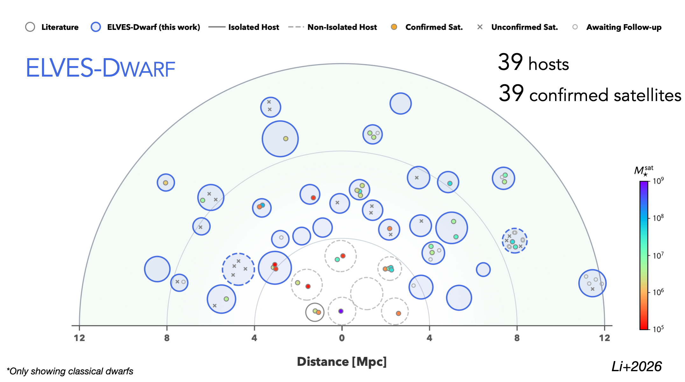
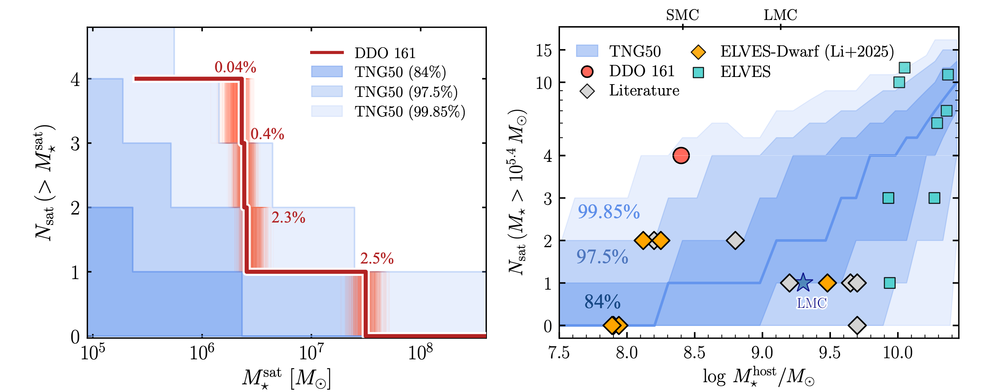
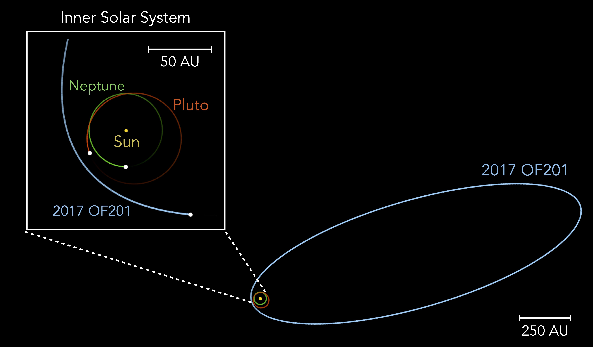
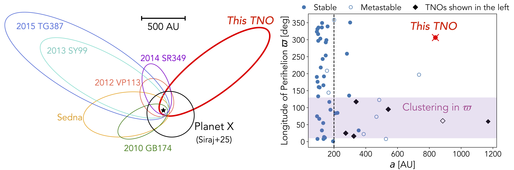
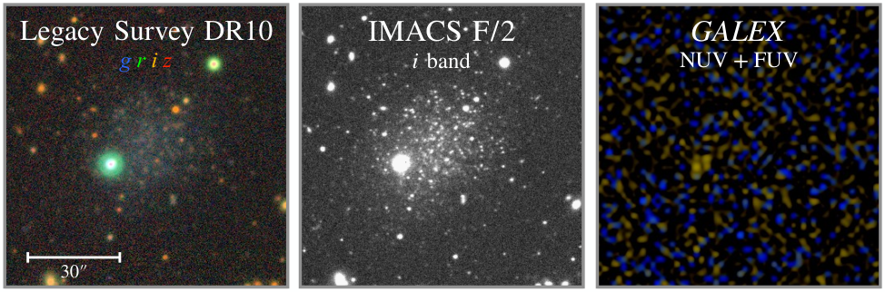
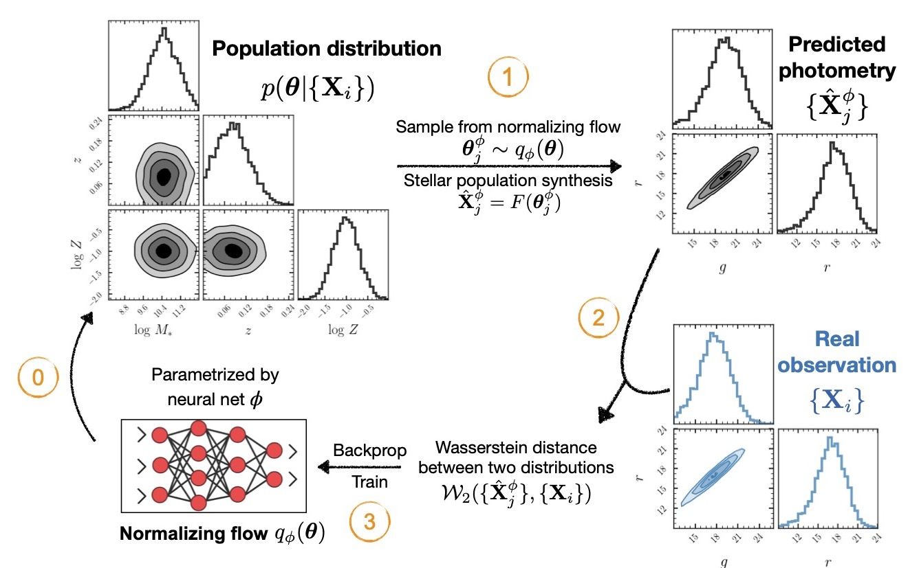
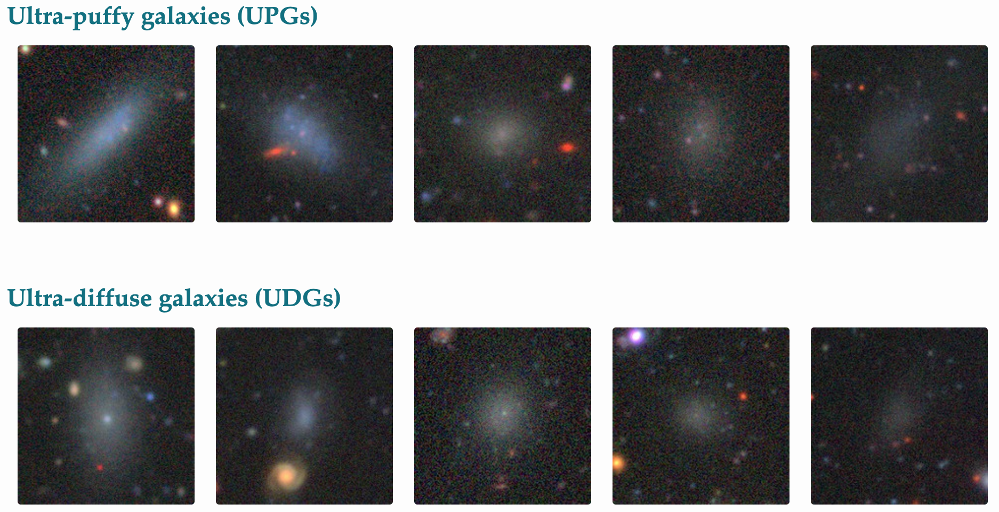
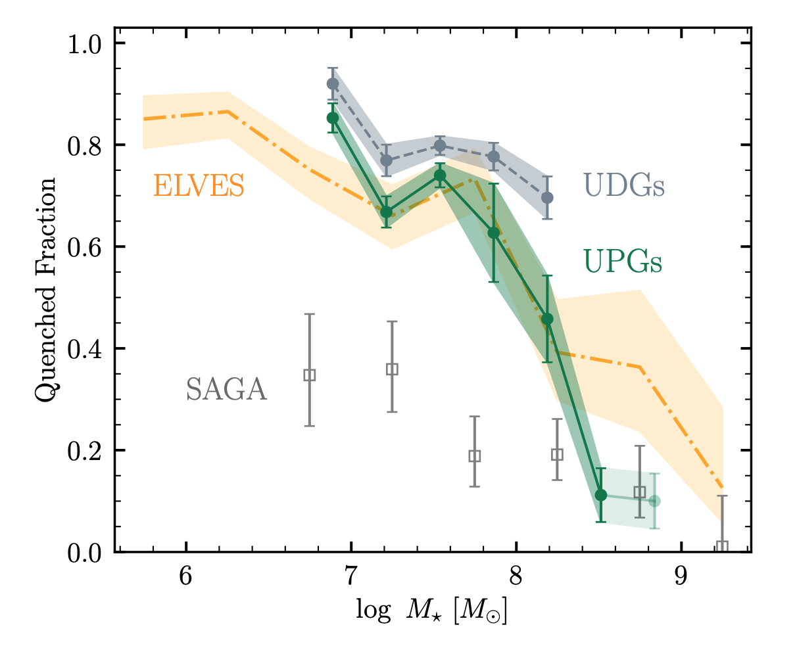
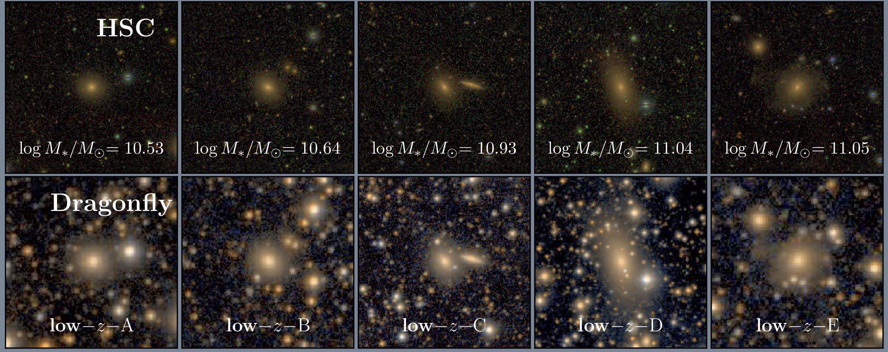
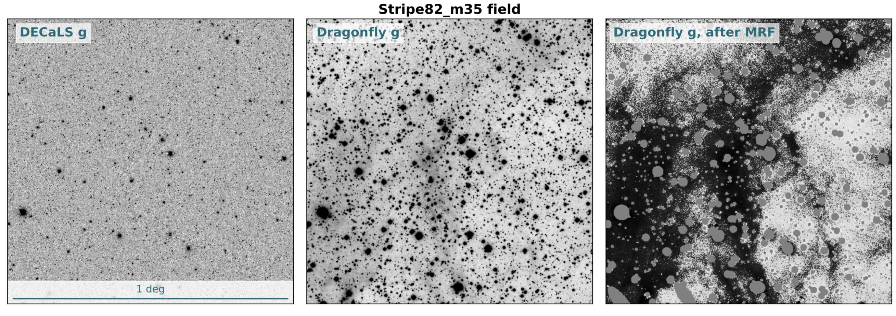

  

    Dwarf galaxies, dark matter on small scales, low-surface-brightness surveys, and statistical methods.
    
      <a href="{{ '/publications/' | relative_url }}">Publications &rarr;</a>
      &middot;
      <a href="{{ '/software/' | relative_url }}">Software &rarr;</a>
    
  

  <!-- Topic Filter Tabs -->
  

    <button type="button" class="res-tab is-active" data-topic="all" role="tab" aria-selected="true">
      All (8)
    </button>
    <button type="button" class="res-tab" data-topic="dwarfs" role="tab" aria-selected="false">
      Dwarf Galaxies (4)
    </button>
    <button type="button" class="res-tab" data-topic="lsb" role="tab" aria-selected="false">
      LSB &amp; Outskirts (2)
    </button>
    <button type="button" class="res-tab" data-topic="methods" role="tab" aria-selected="false">
      Methods &amp; Inference (2)
    </button>
    <button type="button" class="res-tab" data-topic="solar" role="tab" aria-selected="false">
      Outer Solar System (1)
    </button>
  

  <!-- Flagship Survey Hero -->
  <section class="res-hero" data-res-item data-topic="dwarfs">
    

      
Flagship Survey

      <h2 class="res-hero__title">
        <a href="https://elves-surveys.github.io/elves-dwarf/" target="_blank" rel="noopener">ELVES-Dwarf Survey: Satellites of Isolated Dwarf Galaxies in the Local Volume</a>
      </h2>
      

        I lead the <strong>E</strong>xploration of <strong>L</strong>ocal <strong>V</strong>olum<strong>E</strong> <strong>S</strong>atellites of <strong>Dwarf</strong> galaxies (<strong>ELVES-Dwarf</strong>) survey — building the first large, homogeneous, distance-confirmed census of satellites around isolated dwarf hosts (108 &lt; M&lowast; &lt; 1010 M&odot;). Across 39 hosts, we confirm 39 satellites out of 207 candidates via surface brightness fluctuation distances from HSC and Magellan.
      

      

        
          <a href="https://elves-surveys.github.io/elves-dwarf/" target="_blank" rel="noopener">Survey Website &#8599;</a>
          &middot;
          <a href="https://scixplorer.org/abs/2026ApJ..1002...75L/abstract" target="_blank" rel="noopener">Paper I (ApJ 2026) &#8599;</a>
          &middot;
          <a href="https://arxiv.org/abs/2609.00283" target="_blank" rel="noopener">Paper II (arXiv 2026) &#8599;</a>
        
        <button type="button" class="res-details-btn" data-res-toggle="elves" aria-expanded="false">Details</button>
      

      

        
Satellite candidates are identified in integrated light using the Legacy Surveys (complete down to Mg &approx; &minus;9 mag) and confirmed via SBF distances from deep Hyper Suprime-Cam and Magellan imaging. The satellite systems are strikingly diverse: 21 hosts have no confirmed satellites, 10 have one, six have two, and two have four.

        
Overall satellite abundances and stellar mass functions broadly agree with TNG50 and Milky Way-calibrated galaxy&ndash;halo connection models, though strong outliers exist. The quenched fraction of satellites around dwarf hosts is substantially lower than around Milky Way-mass hosts, showing that environmental quenching is far less efficient in dwarf halos.

      

    

    <figure class="res-hero__figure">
      
      <figcaption>39 dwarf hosts across the Local Volume, with 39 distance-confirmed satellites out of 207 candidates.</figcaption>
    </figure>
  </section>

  <!-- 2-Column Visual Portfolio Grid -->
  

    <!-- DDO 161 -->
    <article class="res-project" data-res-item data-topic="dwarfs">
      

        
      

      <h3 class="res-project__title">
        <a href="https://scixplorer.org/abs/2026ApJ...998L..24L/abstract" target="_blank" rel="noopener">DDO 161: A Possible &ldquo;Too-Many-Satellites&rdquo; Problem</a>
      </h3>
      

        With four Magellan-confirmed satellites above M&lowast; &gt; 105.4 M&odot;, the isolated dwarf galaxy DDO 161 (at 6 Mpc) is the most satellite-rich dwarf known — lying at the 0.04% tail of TNG50 predictions.
      

      

        
          <a href="https://scixplorer.org/abs/2026ApJ...998L..24L/abstract" target="_blank" rel="noopener">ApJL (2026) &#8599;</a>
          &middot;
          <a href="https://arxiv.org/abs/2511.01733" target="_blank" rel="noopener">arXiv &#8599;</a>
        
        <button type="button" class="res-details-btn" data-res-toggle="ddo161" aria-expanded="false">Details</button>
      

      

        
We identified eight satellite candidates within the projected virial radius of DDO 161 (M&lowast; &approx; 108.4 M&odot;) and confirmed four satellites through surface brightness fluctuation distances from deep Magellan imaging. Its unusually rich satellite system exceeds expectations from Milky Way-calibrated galaxy&ndash;halo models and offers a direct small-scale test of &Lambda;CDM and dark matter physics.

      

    </article>

    <!-- 2017 OF201 -->
    <article class="res-project" data-res-item data-topic="solar">
      

        
      

      <h3 class="res-project__title">
        <a href="https://scixplorer.org/abs/2026ApJ...998L...6C/abstract" target="_blank" rel="noopener">2017 OF201: Dwarf Planet Candidate in an Extremely Wide Orbit</a>
      </h3>
      

        With Sihao Cheng (IAS) and Eritas Yang (Princeton), we discovered a ~700 km trans-Neptunian object on a 25,000-year orbit (a &approx; 840 au, e &approx; 0.946) that challenges the Planet Nine apsidal-clustering hypothesis.
      

      

        
          <a href="https://scixplorer.org/abs/2026ApJ...998L...6C/abstract" target="_blank" rel="noopener">ApJL (2026) &#8599;</a>
          &middot;
          <a href="https://en.wikipedia.org/wiki/2017_OF201" target="_blank" rel="noopener">Wikipedia &#8599;</a>
          &middot;
          <a href="https://www.nytimes.com/2025/05/29/science/dwarf-planet-nine-discovery.html" target="_blank" rel="noopener">NYT &#8599;</a>
        
        <button type="button" class="res-details-btn" data-res-toggle="tno" aria-expanded="false">Details</button>
      

      

        
Spotted in archival DECaLS (DECam) and CFHT data spanning over 7 years, 2017 OF201 is currently ~90 au from the Sun and sits outside the apsidal clustering of other extreme TNOs. Because it is detectable by DECaLS-depth surveys for only ~0.5% of its orbital period, it implies a substantial hidden outer Solar System population awaiting Rubin LSST.

        
<strong>Press:</strong> <a href="https://www.ias.edu/news/extreme-cousin-pluto-possible-dwarf-planet-discovered-solar-systems-edge" target="_blank" rel="noopener">IAS</a> &middot; <a href="https://web.astro.princeton.edu/news/princeton-astronomers-discover-extraordinary-distant-object-solar-systems-edge" target="_blank" rel="noopener">Princeton</a> &middot; <a href="https://skyandtelescope.org/astronomy-news/another-dwarf-planet-in-our-solar-system/" target="_blank" rel="noopener">Sky &amp; Telescope</a> &middot; <a href="https://phys.org/news/2025-05-extreme-cousin-pluto-dwarf-planet.html" target="_blank" rel="noopener">Phys.org</a> &middot; <a href="https://www.newscientist.com/article/2481477-new-dwarf-planet-spotted-at-the-edge-of-the-solar-system/" target="_blank" rel="noopener">New Scientist</a>

        
        
Plan view of extreme TNO orbits showing 2017 OF201 outside the apsidal clustering.

      

    </article>

    <!-- Hedgehog -->
    <article class="res-project" data-res-item data-topic="dwarfs">
      

        
      

      <h3 class="res-project__title">
        <a href="https://scixplorer.org/abs/2024ApJ...975L..23L/abstract" target="_blank" rel="noopener">Hedgehog: An Isolated Quiescent Dwarf Galaxy at 2.4 Mpc</a>
      </h3>
      

        Discovery of dw1322m2053 (&ldquo;Hedgehog&rdquo;), a quiescent dwarf galaxy with no neighbors within 1 Mpc and 1.7 Mpc from Centaurus A — one of the most isolated quenched dwarfs known at its stellar mass.
      

      

        
          <a href="{{ '/research/Hedgehog/' | relative_url }}">3D Map &rarr;</a>
          &middot;
          <a href="https://scixplorer.org/abs/2024ApJ...975L..23L/abstract" target="_blank" rel="noopener">ApJL (2024) &#8599;</a>
          &middot;
          <a href="https://aasnova.org/2024/11/06/discovery-of-a-lonely-galactic-hedgehog/" target="_blank" rel="noopener">AAS Nova &#8599;</a>
          &middot;
          <a href="https://www.youtube.com/watch?v=-cpowWCC2-M" target="_blank" rel="noopener">Video &#8599;</a>
        
        <button type="button" class="res-details-btn" data-res-toggle="hedgehog" aria-expanded="false">Details</button>
      

      

        
Measured via surface brightness fluctuations from Legacy Surveys and deep Magellan/IMACS imaging, Hedgehog exhibits a red optical color, early-type morphology, and no UV emission. It may be a backsplash galaxy ejected from the Centaurus A group, or quenched in the field by cosmic-web ram pressure, reionization, or internal stellar feedback.

      

    </article>

    <!-- PopSED -->
    <article class="res-project" data-res-item data-topic="methods">
      

        
      

      <h3 class="res-project__title">
        <a href="https://scixplorer.org/abs/2024AJ....167...16L/abstract" target="_blank" rel="noopener">PopSED: Population-Level Inference from Broadband Photometry</a>
      </h3>
      

        A normalizing-flow framework that infers galaxy population distributions directly from photometry by minimizing Wasserstein distance — recovering 100k galaxies in 1 GPU-hour (106&times; faster than per-galaxy SED fitting).
      

      

        
          <a href="https://scixplorer.org/abs/2024AJ....167...16L/abstract" target="_blank" rel="noopener">AJ (2024) &#8599;</a>
          &middot;
          <a href="https://github.com/AstroJacobLi/popsed" target="_blank" rel="noopener">GitHub &#8599;</a>
          &middot;
          <a href="https://aas243-aas.ipostersessions.com/default.aspx?s=17-8B-BF-EA-85-AA-3F-8F-05-B7-9F-FD-F4-22-2F-BA&guestview=true" target="_blank" rel="noopener">AAS Poster &#8599;</a>
        
        <button type="button" class="res-details-btn" data-res-toggle="popsed" aria-expanded="false">Details</button>
      

      

        
Validated on mock observations and applied to GAMA galaxies at z &lt; 0.1, PopSED reliably recovers redshift, stellar mass distributions, and the star-forming main sequence directly at the population level. Our AAS 243 poster won the <a href="https://aas.org/posts/news/2023/01/congratulations-aas-243-chambliss-student-award-winners" target="_blank" rel="noopener">Chambliss Astronomy Achievement Student Award</a>.

      

    </article>

    <!-- Beyond UDG I & II -->
    <article class="res-project" data-res-item data-topic="dwarfs lsb">
      

        
      

      <h3 class="res-project__title">
        <a href="{{ '/research/BeyondUDG/' | relative_url }}">Beyond Ultra-Diffuse Galaxies I &amp; II (Ultra-Puffy Galaxies)</a>
      </h3>
      

        Using Subaru HSC-SSP, we defined &ldquo;ultra-puffy&rdquo; galaxies (UPGs) as 1.5&sigma; outliers above the mass&ndash;size relation around Milky Way analogs and showed that environmental quenching is not tied to being a mass&ndash;size outlier.
      

      

        
          <a href="{{ '/research/BeyondUDG/' | relative_url }}">Data Products &rarr;</a>
          &middot;
          <a href="https://scixplorer.org/abs/2023ApJ...955....1L/abstract" target="_blank" rel="noopener">Paper I (2023) &#8599;</a>
          &middot;
          <a href="https://scixplorer.org/abs/2023ApJ...955....2L/abstract" target="_blank" rel="noopener">Paper II (2023) &#8599;</a>
        
        <button type="button" class="res-details-btn" data-res-toggle="upg" aria-expanded="false">Details</button>
      

      

        
Defining UPGs via the mass&ndash;size relation avoids the stellar-population bias of fixed surface-brightness cuts. Across Milky Way analogs at 0.01 &lt; z &lt; 0.04, each host contains NUPG = 0.31 &plusmn; 0.05 (5% of satellites) and NUDG = 0.44 &plusmn; 0.05 (7% of satellites). Paper II shows UPGs share the same quenched fraction as normal-sized satellites, suggesting they form puffy prior to infall and quench via ram-pressure stripping.

        
        
Quenched fractions of UDGs, UPGs, and normal-sized satellites vs. stellar mass.

      

    </article>

    <!-- Reaching for the Edge -->
    <article class="res-project" data-res-item data-topic="lsb">
      

        
      

      <h3 class="res-project__title">
        <a href="https://scixplorer.org/abs/2022MNRAS.515.5335L/abstract" target="_blank" rel="noopener">Reaching for the Edge: Outskirts of Massive Galaxies Across Surveys</a>
      </h3>
      

        Systematic cross-survey benchmark of stellar halos in HSC, DECaLS, SDSS, and the Dragonfly Telephoto Array — reaching 30 mag/arcsec2 with Dragonfly and 150&ndash;200 kpc with HSC.
      

      

        
          <a href="https://scixplorer.org/abs/2022MNRAS.515.5335L/abstract" target="_blank" rel="noopener">MNRAS (2022) &#8599;</a>
        
        <button type="button" class="res-details-btn" data-res-toggle="edge" aria-expanded="false">Details</button>
      

      

        
HSC and DECaLS surface-brightness profiles of intermediate-redshift massive galaxies agree down to 28 mag/arcsec2 (~100 kpc), with DECaLS recovering stellar mass within 100 kpc to 0.05 dex relative to HSC — providing a practical calibration benchmark for wide-field low-surface-brightness science.

      

    </article>

    <!-- Multi-Resolution Filtering -->
    <article class="res-project" data-res-item data-topic="methods">
      

        
      

      <h3 class="res-project__title">
        <a href="https://scixplorer.org/abs/2020PASP..132g4503V/abstract" target="_blank" rel="noopener">Multi-Resolution Filtering for Faint Extended Emission</a>
      </h3>
      

        An empirical, self-contained method (<code>mrf</code>) developed for the Dragonfly Telephoto Array to subtract compact sources using higher-resolution imaging and isolate faint, diffuse emission.
      

      

        
          <a href="https://scixplorer.org/abs/2020PASP..132g4503V/abstract" target="_blank" rel="noopener">PASP (2020) &#8599;</a>
          &middot;
          <a href="https://github.com/AstroJacobLi/mrf" target="_blank" rel="noopener">GitHub &#8599;</a>
          &middot;
          <a href="https://mrfiltering.readthedocs.io/en/latest/" target="_blank" rel="noopener">Docs &#8599;</a>
        
        <button type="button" class="res-details-btn" data-res-toggle="mrf" aria-expanded="false">Details</button>
      

      

        
Developed with Pieter van Dokkum, <code>mrf</code> removes stars and bright galaxies down to a predefined surface-brightness threshold in low-spatial-resolution, ultra-deep imaging, while also providing a calibrated method for measuring scale-dependent surface-brightness detection limits.

      

    </article>

  

<!-- Click-to-zoom figure modal -->

  

    <button type="button" class="res-zoom-modal__close" id="res-zoom-close" aria-label="Close figure">&times;</button>
    
    

  

