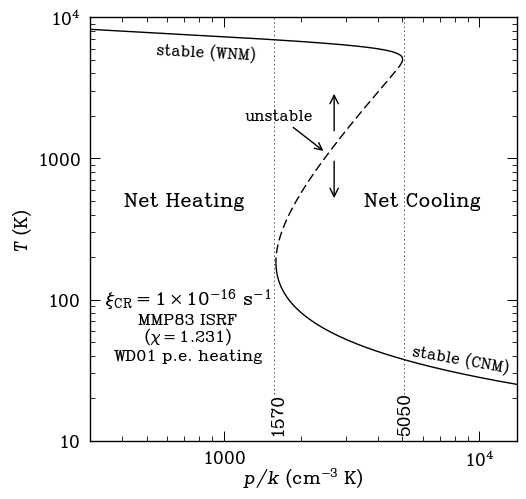

  

    Open-source tools for astronomical simulations, plotting, and research workflows.
    <a href="https://github.com/AstroJacobLi" target="_blank" rel="noopener">GitHub (@AstroJacobLi) &#8599;</a>
  

  

    <article class="sw-item">
      

        

          <a class="sw-item__name" href="https://github.com/AstroJacobLi/Rosesim" target="_blank" rel="noopener">Rosesim</a>
          &middot; Python
        

        

          A forward-modeling simulator for the Nancy Grace Roman Space Telescope. Rosesim generates realistic synthetic observations by injecting artificial sources into Roman exposures, enabling tests of source detection, photometry pipelines, and survey completeness for faint and low-surface-brightness galaxies.
        

        

          <a href="https://github.com/AstroJacobLi/Rosesim" target="_blank" rel="noopener">GitHub &#8599;</a>
        

      

      <figure class="sw-item__figure">
        
        <figcaption>Simulated Roman deep-field image</figcaption>
      </figure>
    </article>

    <article class="sw-item">
      

        

          <a class="sw-item__name" href="https://github.com/AstroJacobLi/smplotlib" target="_blank" rel="noopener">smplotlib</a>
          &middot; Python
        

        

          A Matplotlib style library inspired by the classic <em>SuperMongo</em> aesthetic. <code>smplotlib</code> provides clean, publication-ready plot styles with a single import, matching the traditional look of astronomical journals without manual tweaking of <code>rcParams</code>.
        

        

          <a href="https://github.com/AstroJacobLi/smplotlib" target="_blank" rel="noopener">GitHub &#8599;</a>
          &middot;
          <a href="https://pypi.org/project/smplotlib/" target="_blank" rel="noopener">PyPI &#8599;</a>
          &middot;
          <code>pip install smplotlib</code>
        

      

      <figure class="sw-item__figure">
        
        <figcaption>Example figure styled with smplotlib</figcaption>
      </figure>
    </article>
  

  <h2 class="sw-section-heading">BibTeX &amp; CV Utilities</h2>

  

    <article class="sw-util">
      

        <a class="sw-item__name" href="https://github.com/AstroJacobLi/bib2cv" target="_blank" rel="noopener">bib2cv</a>
        &middot; Python
      

      

        A command-line tool that converts a BibTeX <code>.bib</code> file into a formatted publication list for your CV. Automatically sorts entries, highlights author names, and outputs clean LaTeX or plain-text lists.
      

      

        <a href="https://github.com/AstroJacobLi/bib2cv" target="_blank" rel="noopener">GitHub &#8599;</a>
      

    </article>

    <article class="sw-util">
      

        <a class="sw-item__name" href="https://github.com/AstroJacobLi/bib_arxiv_to_published" target="_blank" rel="noopener">bib_arxiv_to_published</a>
        &middot; Python
      

      

        Automatically updates arXiv preprint entries in a BibTeX file to their final published journal references by querying the NASA ADS API and replacing journal, volume, page, and DOI metadata in place.
      

      

        <a href="https://github.com/AstroJacobLi/bib_arxiv_to_published" target="_blank" rel="noopener">GitHub &#8599;</a>
      

    </article>
  

